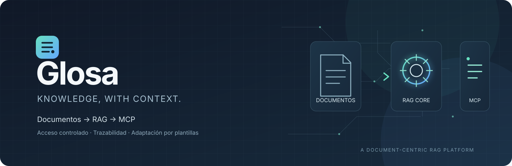

# Glosa

**Sube tus documentos y obtén un RAG consultable y un servidor MCP al que se conecta cualquier LLM, con permisos, cola de trabajos y trazabilidad completa.**

Glosa está pensado para dos cosas a la vez: **enseñar** cómo funcionan RAG y MCP viéndolos funcionar, y **convertirse en un servicio profesional** que se adapta a cada cliente con una plantilla, sin tocar código.

> *Glosa*: la anotación que explica un texto. Es lo que hace la capa didáctica con el sistema.

## Estado

El proyecto está en fase de diseño con un núcleo ya implementado.

| Pieza | Estado |
|-------|--------|
| Especificación (v0.4.1), ADRs, contrato OpenAPI | Hecho |
| Núcleo: entidades, puertos, permisos, tokens, registro encadenado | Implementado, con tests |
| Plantillas de cliente (carga, herencia, guardia de producción) | Implementado, con tests |
| Dockerfile y docker-compose | Hechos |
| Casos de uso, almacenamiento SQLite, API, servidor MCP, worker | Pendiente |
| Frontend | Pendiente |

## Inicio rápido

### En local

```bash
cd backend
python -m venv .venv && source .venv/bin/activate
make install
make test        # 51 tests
make check       # valida la plantilla activa
```

### Con Docker

```bash
cd backend
docker compose up                              # valida la plantilla y termina
GLOSA_TEMPLATE=profesional docker compose up
docker compose --profile test run --rm tests
```

Más detalles en [`backend/README.md`](backend/README.md).

## Cómo funciona

- Las **escrituras** (subir, modificar, borrar, reindexar) se **encolan** y las procesa un worker, en orden por colección y de forma idempotente.
- Las **lecturas** (buscar, leer, listar) son síncronas.
- Cada operación deja una entrada en un **registro de solo añadir**, encadenado con hashes, unido por un `correlation_id` de extremo a extremo.
- Los LLM se conectan al **servidor MCP** con un token de colección. El token fija la colección y sus permisos (`read` por defecto).
- Los permisos los decide **una sola pieza** (`core`), tanto para la API como para MCP.

Todo el detalle está en [`docs/SPEC.md`](docs/SPEC.md).

## Estructura

```
docs/       especificación, ADRs, contrato OpenAPI, glosario, diagramas y licencias de dependencias
backend/    el producto (ver backend/README.md)
frontend/   cliente de la API, reemplazable (ver frontend/README.md)
```

## Adaptación a clientes

Cada cliente o proyecto se define con una **plantilla** YAML que hereda de los presets `didactico` y `profesional`:

```yaml
name: acme-legal
extends: profesional
mcp:
  tools:
    buscar: "Busca cláusulas en los contratos de Acme"
metadata: [fecha_contrato, jurisdiccion]
```

Las plantillas solo pueden elegir piezas y ajustes seguros: los invariantes (aislamiento por colección, autorización única, registro de solo añadir) no son configurables, y en modo producción el arranque se niega a usar credenciales de demo. Ver [`docs/SPEC.md`](docs/SPEC.md) §18.

## Licencia

Código disponible (*source-available*), **no** open source en sentido estricto.

- **Gratis** para personas y pequeñas empresas: licencia PolyForm Small Business 1.0.0 (`LICENSE`).
- **De pago** para las empresas que superen sus límites: licencia comercial (`LICENSE-COMERCIAL.md`, borrador).
- Para contribuir con código hace falta firmar el CLA (`CLA.md`). Ver [`CONTRIBUTING.md`](CONTRIBUTING.md).

> Los textos de licencia son un borrador sin revisión legal, y `LICENSE` aún necesita el texto oficial y el titular legal. Ver [`docs/SPEC.md`](docs/SPEC.md) §19.6.

## Apoya el proyecto

Si lo usas y puedes, ayuda a que siga adelante. Es voluntario y no condiciona la licencia.

`<enlace de apoyo: GitHub Sponsors, Open Collective, Liberapay...>`

## Siguiente paso

Implementar los casos de uso de `core` (`backend/packages/core/src/glosa_core/usecases/`), empezando por los tests: crear colección, emitir token, subir documento y buscar. Después, el adaptador de almacenamiento en SQLite.
